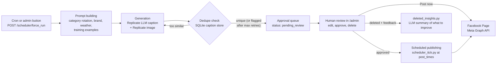

# VibePilot

[](https://github.com/yboredintampa/vibepilot-oss/actions/workflows/ci.yml)
[](LICENSE)

VibePilot is a self-hosted, artificial intelligence (AI) social-media autopilot
for local service businesses. It writes on-brand captions with a large
language model (LLM), generates a matching image, puts every post in a
**human approval queue**, and publishes approved posts to a Facebook Page on a
schedule. A companion service collects **verified customer reviews** through
signed Quick Response (QR) codes.

The repository ships with a fictional demo business, **Sunny Side Pool Co.**
(a pool-service company), and a pool-care training corpus in `content/`.
Swap in your own business through environment variables and training files.

## Features

- **AI content generation**: captions (LLM via Replicate) and companion images
  in several styles: realistic, educational, meme, persuasive, comedic,
  confrontational, blog.
- **Duplicate protection**: every generated caption is checked against a
  local SQLite store of earlier captions and regenerated if it is too similar.
- **Approval queue and admin dashboard**: review, edit, approve, delete (with
  feedback) or post immediately from `/admin`.
- **Scheduler**: posting times and category rotation
  (`apps/api/scheduler_config.json`), driven by cron.
- **Facebook publishing** via the Meta Graph application programming
  interface (API).
- **Blog generation**: long-form articles with a hero image (`blog_poster.py`).
- **Context-aware posts**: optional weather context (Open-Meteo).
- **Multi-tenant API basics**: tenants, users, brand profiles and post history
  scoped by tenant (`apps/api/api.py`).
- **Telegram notifications** and an optional Telegram command bot.
- **Verified reviews (`vibepilot-backend`)**: hash-based message
  authentication code (HMAC) signed QR tokens, review landing page, printable
  sticker sheets, analytics, call-to-action (CTA) optimizer.

## How the AI pipeline works



1. **Prompt building** (`apps/api/poster.py`). Each run picks the next
   category from `CATEGORY_ROTATION` (or the one requested), adds the business
   name and location from `BUSINESS_*` variables, optional current weather
   (`weather_client.py`), a tone note for the category, and up to three example
   captions from `content/pools_<category>_training.txt`. If the optional
   reviews service is configured (`VP_BACKEND_URL`), examples are weighted
   toward captions that performed well.
2. **Generation**. The caption comes from the Replicate model in
   `REPLICATE_LLM`; if Replicate is unavailable a fixed fallback caption is
   used. The image prompt is built from the category and caption and rendered
   by a Replicate image model (`image_prompt_manager.py`). No image means no
   post: the run stops instead of queueing a text-only post.
3. **Dedupe** (`apps/api/dedupe_store.py`). The caption is compared with
   stored captions: exact match, fuzzy similarity of 0.92 or more, or a
   near-identical opening phrase. Duplicates are regenerated up to
   `CAPTION_DEDUPE_ATTEMPTS` times (default 3). If every attempt collides, the
   post is still queued with `metadata.possible_duplicate_of` so the reviewer
   can see it. Queued captions are saved to the store.
4. **Human approval queue** (`apps/api/post_queue.py`, `admin_dashboard.py`).
   Each post is a JavaScript Object Notation (JSON) file in `POST_QUEUE_DIR`
   with status `pending_review`. Nothing is published until an admin approves
   it in `/admin`. Deleting a post asks for a rating and a note;
   `deleted_insights.py` (run on demand or from cron) asks the LLM to summarize the
   patterns, and the dashboard shows the result at `/admin/insights/deleted`.
   Setting `POST_MODE=direct` also publishes each post to Facebook right
   away, bypassing review; the default, `queue`, waits for approval.
5. **Scheduled publishing** (`apps/api/scheduler_tick.py`). Run by cron
   (`bin/vp_tick.sh`), it checks the `post_times` in
   `scheduler_config.json`; when a slot is due it posts the **oldest approved,
   not-yet-posted** item to Facebook, marks it `posted`, and records the slot
   so it posts only once per slot per day. Admins can also press **Post now**
   on an approved card. See `deploy/crontab.example` for a full schedule.

### Tenant isolation

The multi-tenant API (`apps/api/api.py` with `auth.py`, `brand.py`,
`content.py`, `storage.py`) stores tenants, users, brand profiles and content
posts in PostgreSQL. A signed JSON Web Token (JWT) session cookie carries the
user's tenant identifier (ID); every brand and content query filters on that
tenant ID, and uploaded files are stored under a per-tenant key prefix in the
object store. Users are looked up by a SHA-256 (Secure Hash Algorithm,
256-bit) hash of their email. The production queue pipeline in `main.py` is
single-business: it is configured by environment variables for one brand and
one Facebook Page.

### Authentication and rate limits

- Admin endpoints require an admin session cookie (username and password from
  `VP_ADMIN_USER` / `VP_ADMIN_PASS`, compared in constant time) or
  `Authorization: Bearer $VP_INTERNAL_API_TOKEN` for cron and scripts. The
  reviews service accepts `VP_BACKEND_ADMIN_TOKEN` or Hypertext Transfer
  Protocol (HTTP) Basic admin credentials.
- Both services **refuse to start** if a required secret is missing, too
  short, or a known placeholder. There are no built-in default secrets.
- Admin login, demo login and the public review endpoints are rate-limited
  (in memory, per process). `X-Forwarded-For` is only trusted when
  `TRUST_PROXY_HEADERS=true`.
- API docs (`/docs`, `/openapi.json`) are off unless `VP_ENABLE_DOCS=true`;
  the passwordless demo login is off unless `VP_ENABLE_DEMO_LOGIN=true`.

### HMAC-signed QR review tokens

`vibepilot-backend/backend/services/qr_service.py` builds tokens of the form
`user_id:job_id:timestamp:signature`, where the signature is
HMAC-SHA-256 over the first three parts using
`QR_SIGNING_SECRET`. On scan, the service checks the format, rejects tokens
older than 60 days, and compares signatures in constant time, so a customer
cannot forge or edit a review link. Verified scans and ratings are logged to a
JSON analytics store (`VP_ANALYTICS_PATH`).

## Repository layout

| Path | What it is |
| --- | --- |
| `apps/api/` | Main FastAPI service (`main.py` is the Docker entrypoint; `api.py` is the multi-tenant API) |
| `apps/static/` | Admin dashboard HTML served at `/admin` |
| `apps/api/web/`, `vibepilot-ui/` | React + Vite front-ends (TypeScript) |
| `vibepilot-backend/` | QR verified-reviews service (FastAPI, SQLAlchemy) |
| `packages/ui/` | Shared dashboard component |
| `content/` | Training/example captions for the demo business |
| `database/schema/` | PostgreSQL schema (auto-applied by the compose `db` service) |
| `bin/`, `scripts/`, `deploy/` | Host cron helpers, backup script, example crontab |
| `tenants/` | Per-tenant env examples (real `*.env` files are git-ignored) |

## Tech stack

Python 3.12 · FastAPI · Uvicorn · PostgreSQL 16 (psycopg / psycopg2) · SQLite
(dedupe store) · PyJWT · Replicate · Meta Graph API · boto3 (Storj Simple
Storage Service (S3) compatible gateway) · Pillow · qrcode · ReportLab ·
React 19 + Vite + TypeScript · Docker Compose · GitHub Actions.

## Quickstart

### Option A: Docker Compose (API + PostgreSQL)

Requires Docker Engine with Compose v2.

```bash
git clone https://github.com/yboredintampa/vibepilot-oss.git
cd vibepilot-oss
cp .env.example .env
# Fill in at least VP_ADMIN_USER, VP_ADMIN_PASS, VP_INTERNAL_API_TOKEN,
# JWT_SECRET and DB_PASSWORD. Generate secrets with: openssl rand -hex 32
# For local plain HTTP also set VP_COOKIE_SECURE=false.
# Add REPLICATE_API_TOKEN to generate posts, META_PAGE_ID and
# META_PAGE_ACCESS_TOKEN to publish them.
docker compose up -d --build
curl http://127.0.0.1:8000/health
```

`compose.yml` starts two containers: `vp-api` (the API, bound to
`127.0.0.1:8000`) and `db` (PostgreSQL 16, initialised from
`database/schema/`). Open `http://127.0.0.1:8000/admin` and sign in with
`VP_ADMIN_USER` / `VP_ADMIN_PASS`. In production, put a reverse proxy with
Transport Layer Security (TLS) in front; see [DEPLOYMENT.md](DEPLOYMENT.md).

### Option B: local Python 3.12

Use Python **3.12** (the pinned dependencies do not all have wheels for
newer versions yet).

```bash
python3.12 -m venv .venv && . .venv/bin/activate
pip install -r apps/api/requirements.txt
cp .env.example .env            # fill in the required values
cd apps/api && uvicorn main:app --reload --env-file ../../.env
```

The QR reviews service is a separate process with its own requirements:

```bash
pip install -r vibepilot-backend/requirements.txt
cd vibepilot-backend && uvicorn backend.main:app --port 8001 --env-file ../.env
```

It needs `QR_SIGNING_SECRET`, `VP_BACKEND_ADMIN_TOKEN`, `VP_ADMIN_USER`,
`VP_ADMIN_PASS` and `DATABASE_URL`.

Front-ends (Node.js 20.19+ or 22):

```bash
(cd vibepilot-ui && npm ci && npm run build)
(cd apps/api/web && npm ci && npm run build)
```

## Configuration

Every setting is an environment variable documented in
[`.env.example`](.env.example) (placeholders only; never commit a real
`.env`).

## Tests

Two pytest suites cover security and pipeline behaviour (start-up secret
checks, authentication on every admin route, rate-limit header handling, QR
token signing and tamper detection, input validation, caption dedupe, and the
not-implemented stubs). They need no external services: secrets are generated
per run and no database server is contacted.

```bash
pip install pytest httpx

pip install -r apps/api/requirements.txt
(cd apps/api && python -m pytest -q tests)          # 21 tests

pip install -r vibepilot-backend/requirements.txt
(cd vibepilot-backend && python -m pytest -q tests) # 20 tests
```

Continuous integration (CI) runs both suites on Python 3.12 and builds both
front-ends on every push and pull request
([`.github/workflows/ci.yml`](.github/workflows/ci.yml)).

## Roadmap

Not implemented yet. These are left unfinished on purpose rather than faked:

- **Caption translation**: `POST /admin/item/{id}/translate` returns
  `501 Not Implemented`. `apps/api/translate_post.py` contains a draft
  Replicate-based translator that is not wired in.
- **Per-business profiles in the reviews service**: review notification
  emails go to `REVIEW_NOTIFICATION_EMAIL` and public pages use
  `BUSINESS_NAME`; looking these up per business from the database is still
  to do.
- **Storing full reviews**: `/qr/submit-review` verifies the token, logs the
  rating to the analytics store and emails the owner, but the review text and
  customer name are not persisted. The discount code it returns is a static
  demo value.
- **On-chain anchoring of customer-rating hashes**: not implemented;
  `/qr/rate-customer` stores ratings in the analytics store only.
- **Command center metrics**: `/command-center/json` in `apps/api` returns
  placeholder numbers until it is connected to the database.
- **User sign-up and login for the multi-tenant API**: today the only way to
  get a tenant session is the demo login, which is disabled by default.
- **Shared rate-limit store** (for example Redis) for multi-instance
  deployments; the current limiter is in memory per process.

## Contributing

Issues and pull requests (PRs) are welcome.

1. Fork the repo and create a feature branch.
2. Keep secrets out of commits (`.env` is git-ignored; use `.env.example`).
3. Run both pytest suites and the front-end builds before opening a PR.
4. Describe the change and how you tested it.

Please report security issues privately; see [SECURITY.md](SECURITY.md).

## About the author

Built by Todd Bullock (github.com/yboredintampa).

## License

[MIT](LICENSE) © 2026 Todd Bullock
